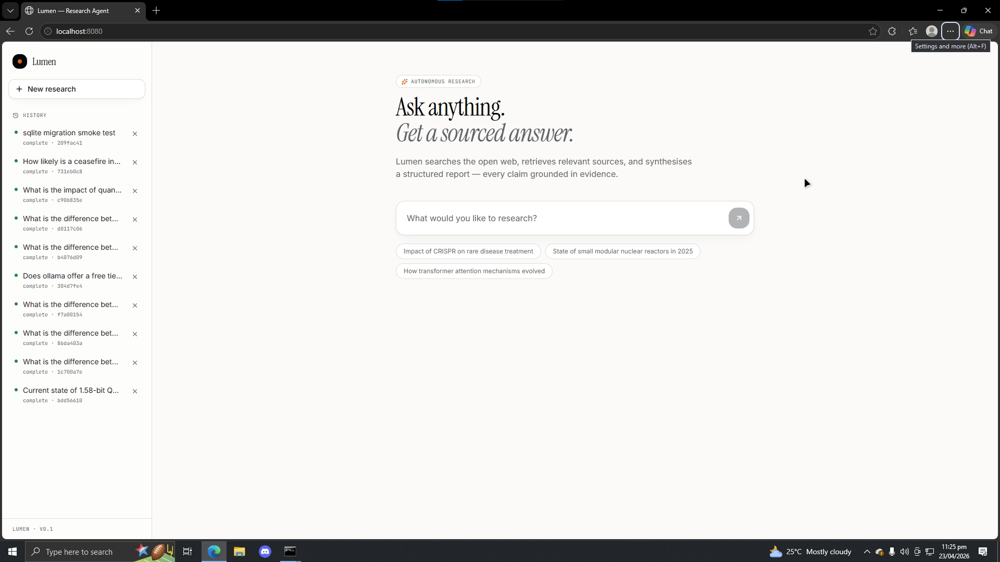

# Lumen Research Agent

Lumen searches the open web, retrieves evidence, reranks it with a local cross encoder, and generates a structured research report with sources. FastAPI application jobs and the encoder evaluation CLI share one backend pipeline.



## Quickstart

Use Python 3.10 or later and Node.js 18 or later for the frontend. Install the backend packages in your development environment:

```powershell
python -m pip install -r requirements.txt
```

Install the Torch build appropriate to your GPU if you want CUDA inference. The local reranker uses CUDA when available, otherwise CPU. Models load on first use; cached models or download access are required.

Copy `.env.example` to `.env` and set Tavily, Groq, and Gemini keys. Gemini handles initial planning and the conditional synthesis fallback. SQLite works without a Redis server.

```powershell
uvicorn backend.main:app --reload --port 8000
```

Start the frontend in another terminal:

```powershell
cd frontend
npm install
npm run dev
```

Open the frontend URL printed by Vite, normally `http://localhost:8080`.

## Shared backend pipeline

`POST /research` schedules `services.run_research_task`, which manages the job lifecycle and calls `pipeline.run_pipeline`. `debug_runner_clean_encoder.py` calls the same function.

1. Decompose and expand the topic into multiple search questions.
2. Search each question sequentially and record those exact results once.
3. Resolve source text, clean web noise, and split it into overlapping sentence-aware chunks.
4. Embed all cleaned chunks with MiniLM and index them with job metadata.
5. Retrieve up to 40 candidates with BM25 and dense vectors merged through RRF.
6. Rerank those candidates with `BAAI/bge-reranker-base`, remove near-duplicates, and select up to eight chunks using proportional source quotas.
7. Synthesize from the exact selected evidence with an explicit topic and source labels, then run the existing claim-similarity grounding layer.

The old application's LLM scoring before indexing, first-30-chunk limit, and sufficiency loop are not on the default path. App jobs still provide progress, history, optional live streaming, and grounding results. Grounding uses embedding similarity, not proof that each claim is correct.

[Read the architecture, decisions, migration differences, and limitations](docs/ENCODER_PIPELINE_ARCHITECTURE.md).

## Where to make changes

| File | Responsibility |
| --- | --- |
| `backend/pipeline.py` | Stage sequencing, timing, and error propagation only |
| `backend/agent.py` | Topic planning and question expansion |
| `backend/searcher.py` | Web discovery, pacing, and per-query logging |
| `backend/scraper.py` | Source extraction and HTTP fallback |
| `backend/chunker.py` | Text cleaning, chunk preparation, and stable chunk IDs |
| `backend/evidence.py` | Duplicate detection, source ordering, and proportional selection |
| `backend/retrieval.py` | Candidate retrieval through final evidence selection |
| `backend/reranker.py` | Lazy local cross-encoder inference and timing |
| `backend/hybrid_retrieval.py` | BM25 plus dense reciprocal rank fusion |
| `backend/vecstore.py` | Embedding model, FAISS, job isolation, checkpoint persistence |
| `backend/synthesizer.py` | Topic-aware prompt, generation, streaming, grounding |
| `backend/services.py` | Job lifecycle, persistence, corpus indexing, diagnostics, and stream queues |
| `backend/models.py` | API models and diagnostic snapshot data contract |
| `backend/main.py` | HTTP API |
| `debug_runner_clean_encoder.py` | Thin CLI adapter and helper compatibility exports |

Make pipeline changes in these shared modules so both the API and encoder CLI receive them. Other experiment runners remain separate historical implementations and are not the application source of truth.

## API

| Endpoint | Purpose |
| --- | --- |
| `POST /research` | Start research from `{ "topic": "..." }` |
| `GET /status/{job_id}` | Job state, report, timings, and grounding |
| `GET /jobs` | Research history |
| `GET /conversations/{conversation_id}` | Ordered questions, reports, and status for a conversation |
| `DELETE /jobs/{job_id}` | Delete history and in-memory job state |
| `GET /stream/report/{job_id}` | Live report text or terminal report replay |
| `GET /debug/synthesis/{job_id}` | Shared pipeline diagnostic snapshot |
| `GET /health` | Health check |

Failures end jobs with `status=error` and close report streams. Partial token streams are never restarted into a second concatenated report.

## Follow-up conversations

The original input stays available below the reports. Follow-ups append to the same conversation, and previous questions and answers remain visible. Selecting a history entry restores its full conversation; refreshing the page reopens the last selected job when browser storage is available. New research starts an independent conversation.

Start with `POST /research` and `{ "topic": "Explain hybrid retrieval" }`. The response includes `job_id` and `conversation_id`. To continue, send `{ "topic": "What are its limitations?", "conversation_id": "<returned conversation_id>" }` to the same endpoint. Each turn remains its own research job, preserving status and streaming APIs.

FastAPI stores ordered turns and full reports in SQLite. It builds model context from completed turns in that conversation, resolves follow-up references into a standalone retrieval topic, and includes conversation history in synthesis. Earlier answers are conversational context, not verified evidence. Model input is bounded to the original exchange plus recent exchanges, up to six prior completed turns and 12,000 characters; complete history remains persisted. Existing job databases are migrated additively. Unknown conversations return 404, and submitting while an answer in that conversation is still running returns 409.

## CLI diagnostics

```powershell
python debug_runner_clean_encoder.py "How does hybrid retrieval improve evidence selection?"
```

The CLI writes timestamped JSON under `debug_output`, records a partial snapshot on failure, and exits nonzero when processing fails. Both CLI and app use the same selected-evidence algorithm; provider streaming and model randomness can still change generated report text.

## Configuration

Copy `.env.example` for the supported settings. Main defaults:

| Setting | Default |
| --- | --- |
| `RETRIEVAL_TOP_K` | `40` |
| `MAX_SYNTHESIS_CHUNKS` | `8` |
| `CROSS_ENCODER_MODEL` | `BAAI/bge-reranker-base` |
| `CROSS_ENCODER_BATCH_SIZE` | `32` |
| `CROSS_ENCODER_MAX_CHARS` | `1500` |
| `MAX_RESULTS_PER_QUERY` | `5` |
| `SCRAPE_CONCURRENCY` | `5` |
| `TAVILY_SEARCH_DELAY` | `0.35` |
| `GROQ_MODEL` | `llama-3.3-70b-versatile` |
| `GEMINI_MODEL` | `gemini-2.5-flash` |
| `SYNTHESIS_PROVIDER` | `groq` |
| `VEC_PATH` | `data/faiss_index` |

Use a separate `VEC_PATH` for isolated evaluations. `MAX_ITERATIONS`, `RELEVANCE_THRESHOLD`, and the old scoring delays do not affect the shared default pipeline. Chunk target/overlap remain the evaluated 800/100 character constants.

## Persistence and runtime limits

Reports and history persist in SQLite at `DB_PATH`, default `data/lumen.db`. Redis caching is optional. Lexical job corpora, snapshots, and stream queues live in memory.

Vector writes use an atomically replaced `<VEC_PATH>.store` checkpoint. Existing `.index` and `.meta` files are imported when no checkpoint exists; they remain untouched after migration. A present `.store` is authoritative. The vector index is append-only, and deleting history does not physically compact vectors.

Run one backend worker per vector path: model/index locks coordinate threads within a process, not separate server workers. Streaming uses the existing in-process job queue. Shared pipeline refactoring does not add distributed scheduling or multi-subscriber stream fan-out.

## Verification

```powershell
python -m pip install -r requirements-dev.txt
python -m pytest tests -q
```

Tests use fake API/model boundaries and temporary databases/checkpoints. They exercise shared app/CLI evidence selection, indexing and retrieval, streaming and failure behavior, and vector persistence without paid provider calls. Historical benchmark artifacts are not new results for this migrated pipeline.
