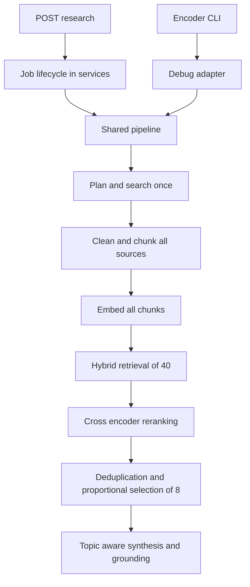

# Lumen Shared Encoder Pipeline Architecture

The live backend and `debug_runner_clean_encoder.py` now execute the same pipeline in `backend/pipeline.py`. The encoder runner is a CLI adapter, not a second implementation. Change shared backend stages to affect both application jobs and subsequent CLI evaluations.

This document describes the migrated implementation. The original static review is retained in [ENCODER_PIPELINE_REVIEW_BEFORE_MIGRATION.md](ENCODER_PIPELINE_REVIEW_BEFORE_MIGRATION.md). Existing benchmark files are historical results; this migration does not rerun or update them.

## Execution paths



The application adapter in `services.run_research_task` persists progress and completion in SQLite, optionally caches state in Redis, and closes its stream on success, failure, or cancellation. The CLI adapter prints progress and writes a timestamped diagnostic JSON file without registering a normal application job. Both adapters call `run_pipeline`.

## Stage contracts and architectural decisions

### Planning

`backend/agent.py` retains the JSON parsing, `decompose_topic`, `followup_sub_questions`, and `ensure_multiple_sub_questions` policies from the evaluated encoder runner. Initial decomposition routes to Gemini. Follow-up task routing remains Groq, preserving the evaluated planner's behavior. The planner accepts up to five questions and uses deterministic topic/developments/limitations variants if needed.

The active pipeline makes one discovery pass. The old sufficiency evaluation helper remains available for compatibility, but `MAX_ITERATIONS`, LLM relevance thresholds, and pre-index first-30-chunk truncation no longer govern application jobs.

### Search

`backend/searcher.py` executes questions sequentially, with `TAVILY_SEARCH_DELAY` between queries and `MAX_RESULTS_PER_QUERY` results per question. It returns exact-URL-deduplicated merged results. An optional `query_results` list records the same response batches for diagnostics. There is no second search solely for logging.

### Extraction and chunk preparation

`backend/scraper.py` resolves source text with semaphore-bounded extraction. Raw Tavily text takes precedence; missing text uses HTML extraction with a ten-second timeout and a 4,000-character fallback limit. The pipeline deliberately retains full nonempty Tavily text, matching the encoder runner.

`backend/chunker.py` owns web-noise cleanup and `prepare_source_chunks`, which converts extracted source text into indexed chunks and source diagnostics. It packs sentence units toward 800 characters, with 100-character overlap and a 50-character minimum. These are character counts rather than token limits. The target can be exceeded when necessary to consume a long sentence with overlap. The short-body branch no longer discards an additional queued sentence.

Preparation runs in a worker thread. Every chunk has a job-global `chunk_index` and a separate `source_chunk_index`; source diagnostics retain both identities. All cleaned chunks are embedded, including those beyond the old application limit of 30.

### Indexing and persistence

`backend/services.py` exposes a lazy vector store, avoiding embedding-model downloads or loading on module/API import. `backend/vecstore.py` uses `all-MiniLM-L6-v2`, 384-dimensional float32 embeddings, and exact `IndexFlatL2` search. Normalization and vector geometry are unchanged from the evaluated code.

`services.index_job_chunks` builds indexed metadata, offloads embedding and insertion, and only appends the aligned job-local BM25 corpus after insertion and checkpointing succeed. Model and index mutations are serialized by a process-local lock. Failed checkpoint writes roll back the newly inserted in-memory vectors and metadata.

New writes use one atomically replaced `<VEC_PATH>.store` checkpoint containing serialized FAISS data, text, and metadata. Existing `.index` and `.meta` files remain readable when no `.store` exists. The first successful insertion creates the new checkpoint without deleting or changing the legacy files. Once present, `.store` is authoritative; legacy index/meta files are historical rather than continuously updated mirrors.

Locks coordinate threads in one application process, not multiple server workers. Run one backend worker against a vector path. Debug runs can set a separate `VEC_PATH` to isolate evaluation vectors. Indexed vectors remain persistent and append-only; job deletion removes history/caches/in-memory state, not physical FAISS rows. Physical compaction and multi-process index coordination are not implemented by this migration.

### Hybrid retrieval

`backend/retrieval.py` invokes `backend/hybrid_retrieval.py` in a worker thread. Dense and lexical branches each retrieve up to `RETRIEVAL_TOP_K` candidates, default 40. RRF adds `1 / (60 + rank)` using one-based positions and returns up to the same configured number of fused hits.

Dense retrieval filters the shared index by job metadata after fetching neighbors, expanding its neighbor search when needed. Already-accepted vector row IDs are deduplicated between expansion rounds, preventing repeated neighbors from prematurely filling the result limit. BM25 is built from the aligned current-job corpus. Dense ranks, BM25 ranks, and RRF scores are included in normal fused-hit diagnostics.

The runner's retrieval source-allowance helper is preserved as a soft ordering policy. Backfilling preserves the candidate pool, so it is not described as a hard source cap. This migration does not replace the evaluated proportional policy with an untested minimum-domain or equal-source policy.

### Cross encoder and final selection

`backend/reranker.py` lazily caches `BAAI/bge-reranker-base`, selects CUDA when available and CPU otherwise, and serializes loading/prediction. Inference runs outside the event loop. Each query-text pair uses the original topic and up to `CROSS_ENCODER_MAX_CHARS` candidate characters, default 1,500, with batch size 32.

Prediction requests identity activation via the installed sentence-transformers 5 API, then applies exactly one stable sigmoid. Scores are relevance-ranking signals, not calibrated factual probabilities. A cached model tokenizer provides unpadded diagnostic lengths; total, load, tokenization, pair construction, and synchronized GPU inference times are recorded. This diagnostic tokenization is additional work and is included in total time.

`backend/evidence.py` greedily removes near-duplicates in score order using the original first-300-character and middle-200-character SequenceMatcher comparisons and threshold greater than 0.85. Cross-source copies are eligible. The highest-ranked occurrence survives.

The original proportional source allocation selects up to `MAX_SYNTHESIS_CHUNKS`, default eight. Source quotas reflect each raw URL/title group's share of deduplicated candidates, with largest-remainder allocation and backfilling. This is page-level proportional diversity, not guaranteed domain diversity. Selected context remains grouped in the original selector's order, which is not necessarily global score order.

### Synthesis and grounding

`backend/synthesizer.py` receives the exact selected chunks. It does not retrieve again, truncate every chunk to 600 characters, or discard additional chunks from the same source. Legacy callers that omit selected evidence are routed through the same shared encoder selector.

The prompt now includes the topic and search questions, full selected evidence, source identifiers, uncertainty instructions, and requests source citations for factual claims. Its Markdown report structure remains executive summary, findings, analysis, practical guidance, limitations, and references.

Default synthesis uses Groq with `GROQ_MODEL`, 1,200 output tokens and temperature 0.2. `SYNTHESIS_PROVIDER=gemini` is supported. The same configured provider/model policy applies to CLI and application jobs; application Groq output can stream while CLI output is non-streaming. Streaming can change provider request behavior and generated text, so identical algorithm/input does not imply byte-identical outputs from a stochastic hosted model.

Provider clients own request retries. Exhausted Groq rate limits switch once to the configured default Gemini model. The old runner's outer 15-second wait, duplicate Groq generation sequence, and hard-coded Gemini 2.0 fallback are removed. Ordinary provider failures propagate. Empty generated text is rejected, and malformed Gemini output is no longer converted to a success-looking string.

A stream may retry before it emits text. Once deltas have reached the user, a failure terminates the job rather than appending a second report or repeating emitted tokens. Streams opened after a terminal error return immediately. Failure paths persist `status=error`; they do not mark an exception string as a completed report.

The existing `ground_report` layer runs for both adapters. It extracts claims and compares embedding cosine similarity to the job corpus; it is not an entailment or citation-validity proof. Its existing no-claims behavior and thresholds are retained. A successful pipeline status means usable generated text and completed processing, not a guarantee of factual accuracy.

## Module map

| Module | Responsibility |
| --- | --- |
| `backend/main.py` | HTTP entry, status/history/debug routes, streaming |
| `backend/agent.py` | Topic planning and question expansion; legacy entry delegates to services |
| `backend/pipeline.py` | Shared stage sequencing, timing, and error propagation only |
| `backend/evidence.py` | Duplicate detection, source ordering, and proportional selection |
| `backend/chunker.py` | Text cleaning, chunk construction, and source/job chunk IDs |
| `backend/scraper.py` | Source extraction and HTML fallback |
| `backend/services.py` | Job lifecycle, corpus indexing, persistence, streams, and diagnostic state |
| `backend/models.py` | API data models and fresh diagnostic snapshot construction |
| `backend/retrieval.py` | Shared hybrid retrieval to selected-evidence boundary |
| `backend/reranker.py` | Cached local cross-encoder inference and diagnostics |
| `backend/searcher.py` | One-pass search with matching per-query diagnostics |
| `backend/vecstore.py` | Lazy embeddings, locking, filtered search and atomic checkpoints |
| `backend/synthesizer.py` | Topic-aware evidence prompt, streaming/generation and grounding |
| `backend/llm_fallback.py` | Shared provider/model/fallback outcome |
| `debug_runner_clean_encoder.py` | CLI and historical helper re-exports |

`backend/scorer.py`, `backend/agentrefactor.py`, `debug_runner_clean.py`, and `runner_encoder_benchmark.py` remain legacy or independent experiment files. They are not called by the default application pipeline. Archived experiments have not been rewritten, rerun, or relabeled as results of this implementation.

## Responsibility boundaries

The existing backend files are reused; this reorganization introduces no new source files or folders. `pipeline.py` calls stage functions and tracks transitions. It does not contain cleaning expressions, chunk construction loops, vector insertion metadata, or the diagnostic schema.

- `agent.plan_research` owns the topic-to-search-question policy.
- `searcher.search_sources` owns discovery and empty-result handling.
- `scraper.extract_parallel` owns source text acquisition.
- `chunker.prepare_source_chunks` owns cleaned chunk construction and source diagnostics.
- `services.index_job_chunks` owns vector/lexical commit ordering.
- `retrieval.select_evidence` coordinates the existing hybrid, reranker, and evidence selection modules.
- `synthesizer.generate` owns report generation and invokes the existing grounding module.
- `models.new_pipeline_snapshot` defines the diagnostic data contract; services initializes and retains each job's state.
- `services.run_research_task` owns application status persistence and terminal stream handling. `agent.run_research_loop` remains a compatibility delegate for older callers.

## Configuration

| Variable | Default | Effect |
| --- | --- | --- |
| `RETRIEVAL_TOP_K` | `40` | Each retrieval branch and fused candidate limit |
| `MAX_SYNTHESIS_CHUNKS` | `8` | Final evidence selection limit |
| `CROSS_ENCODER_MODEL` | `BAAI/bge-reranker-base` | Local relevance model |
| `CROSS_ENCODER_BATCH_SIZE` | `32` | Prediction batch size |
| `CROSS_ENCODER_MAX_CHARS` | `1500` | Reranker text prefix limit |
| `MAX_RESULTS_PER_QUERY` | `5` | Actual search results per question |
| `SCRAPE_CONCURRENCY` | `5` | Maximum extraction concurrency |
| `TAVILY_SEARCH_DELAY` | `0.35` | Seconds between searches |
| `VEC_PATH` | `data/faiss_index` | Vector checkpoint prefix |
| `DB_PATH` | `data/lumen.db` | SQLite job database |
| `GROQ_MODEL` | `llama-3.3-70b-versatile` | Primary synthesis model |
| `GEMINI_MODEL` | `gemini-2.5-flash` | Initial planning and fallback model |
| `SYNTHESIS_PROVIDER` | `groq` | Synthesis primary provider |

API keys are read from environment variables. Keep actual credentials out of version control and diagnostic configuration.

## Diagnostics and failure behavior

### Conversation continuity

`POST /research` accepts an optional `conversation_id`. A new request without one starts a separate conversation; follow-ups with it reserve an ordered job turn under a SQLite transaction. Existing job databases receive additive `conversation_id`, `parent_job_id`, and `turn_index` columns, with old jobs treated as individual conversations. `GET /conversations/{conversation_id}` restores the full ordered transcript. Status responses include the question and conversation identifiers.

Services loads completed earlier turns from SQLite and passes bounded server-side history to the shared pipeline. `agent.resolve_followup_topic` turns references such as “its limitations” into a standalone discovery/retrieval topic; the original follow-up and conversational history are also supplied to synthesis. Earlier generated answers are explicitly distinguished from retrieved source evidence. Full history is stored, while model input retains up to six completed exchanges within a 12,000-character budget. Only one active turn is permitted per conversation; unknown and busy conversations are rejected before scheduling work.

The frontend retains the existing input, report cards, and sidebar styling. It renders previous questions/answers, appends follow-ups, restores conversations from history, and remembers the last selected job across reloads when local storage is available. New research clears the selected conversation. The Vite development proxy also forwards `/conversations` to FastAPI.

`GET /debug/synthesis/{job_id}` now exposes the shared pipeline snapshot, including job ID, timezone-aware timestamp, pipeline version, effective nonsecret retrieval settings, the actual search response batches, source chunks, fused candidates and ranks, all reranker scores, duplicate exclusions, selected context, exact synthesis prompt, actual provider/model, grounding, and stage timings.

Legacy `used_chunks`, `retrieved_chunks`, `used_count`, and `retrieved_count` fields remain available. `chunks_kept_after_rerank` retains `bge_score` as an alias for `score` for older consumers. CLI snapshots use a fixed output directory anchored to the runner's repository location and exclusively created filenames containing a microsecond UTC timestamp plus a random suffix. Command-line topics and model output appear only in JSON data, never in directory or filename components. A failed CLI run still saves partial diagnostics and exits nonzero. CLI lexical and diagnostic memory is released after the snapshot is obtained.

Critical stage failures stop processing and preserve partial diagnostics. Retry handles at most five request attempts, waiting only between attempts. Grounding or generation failures also end application jobs and close their stream.

Snapshots live in application memory until job deletion or process restart; reports/history remain in SQLite. Job corpora are not restored from vector checkpoints after restart. Exact package/model revisions and frozen source snapshots are still necessary for a controlled reproducible benchmark; pipeline version and configuration alone do not establish one.

## Validation and running

Install backend dependencies with `python -m pip install -r requirements.txt`; choose a compatible Torch CUDA wheel for the machine if GPU inference is required. First model use needs cached model files or network access to download them.

```powershell
uvicorn backend.main:app --reload --port 8000
python debug_runner_clean_encoder.py "Your research topic"
python -m pytest tests -q
```

The automated tests fake external APIs and model boundaries, exercise real chunking/BM25/selection and real temporary FAISS checkpoint logic, and use isolated SQLite databases. They cover API/CLI evidence parity, exact prompt reuse, indexing beyond 30 chunks, one search per question, top-40 cross-encoder input, eight selected chunks, persistence, error status, stream termination, no partial-stream report mixing, vector isolation, checkpoint rollback, and one sigmoid scoring.

No new hosted-provider quality benchmark is implied by these tests. The migration intentionally changes prompt contents, retry details, and output validation; prior report-quality scores should not be carried forward as measurements of the new system.
