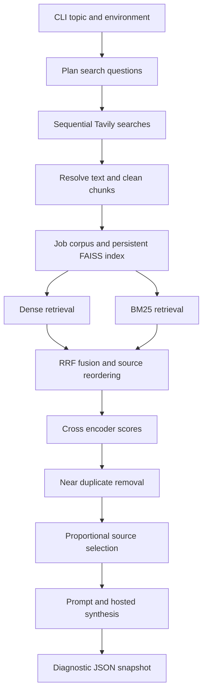

# Lumen Cross Encoder Pipeline Architecture

Reviewed on 16 November 2026. Entry point: `debug_runner_clean_encoder.py`.

## Purpose and main conclusion

This guide explains how the encoder debug runner turns a topic into a web research report, which modules it actually executes, and the architectural decisions that shape its behavior. It also distinguishes this runner from the HTTP application pipeline so the two implementations are not accidentally described as one system.

The runner implements a single-pass retrieval augmented generation pipeline. It decomposes a topic, searches the web, cleans and chunks source material, embeds all chunks, retrieves up to 40 candidates with BM25 plus dense retrieval, reranks those candidates with a local cross encoder, selects up to eight chunks, and asks a hosted language model to synthesize a report. Its main output is a diagnostic JSON snapshot.

The strongest separation is between broad candidate retrieval, more expensive pairwise relevance scoring, and final generation. Important limitations remain: the final prompt omits the explicit topic, the runner does not execute claim grounding, source diversity is heuristic, and some diagnostics do not represent the exact evidence that was searched or indexed.

### Evidence and interpretation

All implementation descriptions below come from the current local source files. Source locations use `file:line` notation; they refer to this reviewed working tree and may shift after edits. Architectural rationale is labeled as inferred where the code does not state a reason. This is a static source review, not a fresh execution or a performance evaluation. No API requests, model downloads, vector insertions, or benchmark runs were made for this review.

The working tree contains existing modifications and untracked files, including the runner itself. HEAD is `abe766e1beb552351cf795acb8d23805aeb32326`; that commit alone does not reproduce the reviewed implementation. Existing source files were left unchanged.

## Pipeline map



Sub-questions control web discovery. The original topic controls hybrid retrieval and cross-encoder scoring. The final synthesis prompt receives the selected source blocks but does not explicitly receive the original topic or sub-questions.

## Module responsibilities

| Module | Responsibility in this runner | Main entry points |
| --- | --- | --- |
| `debug_runner_clean_encoder.py` | Stage orchestration, cleaning, diversity, local reranking, synthesis fallback, snapshots | `main`, `run_debug` |
| `backend/agent.py` | Search question planning and shared search/scrape constants | `decompose_topic`, `followup_sub_questions` |
| `backend/llm_router.py` | Select planning provider by task string | `llm_generate` |
| `backend/searcher.py` | Tavily requests, result normalization, sequential query merging | `search`, `search_queries_sequential` |
| `backend/scraper.py` | Use available text or extract HTML with bounded concurrency | `extract_parallel`, `text_for_result`, `extract` |
| `backend/chunker.py` | Sentence-aware character chunking with overlap | `chunk_text` |
| `backend/services.py` | Shared vector store and job-local lexical corpus | `vec`, `init_job_chunk_storage`, `append_job_chunks`, `get_job_corpus` |
| `backend/vecstore.py` | MiniLM embedding, persistent FAISS storage, job filtering | `VectorStore.add_texts`, `VectorStore.query` |
| `backend/hybrid_retrieval.py` | BM25 and dense ranking fusion | `hybrid_query`, `reciprocal_rank_fusion` |
| `backend/models.py` | Typed reranking result | `ScoredChunk` |
| `backend/synthesizer.py` | Source-block prompt construction only | `build_synthesis_prompt` |
| `backend/groq_client.py` | Primary hosted synthesis and follow-up planning | `groq_generate` |
| `backend/gemini_client.py` | Initial planning and conditional synthesis fallback | `gemini_generate` |
| `backend/retry.py` | Retry Tavily and Groq requests | `async_retry` |

Importing a module does not mean all of its facilities execute. In particular, this runner imports the synthesizer but bypasses its `generate` wrapper, source-deduplication selector, streaming path, and grounding call.

## How one run executes

### Startup and initialization

`load_dotenv()` executes before backend imports, allowing module-level configuration to read environment values. Command-line arguments are joined into one topic. `main()` prints Torch and CUDA information, then calls `asyncio.run(run_debug(topic))`. Missing arguments produce a usage message and exit code 1. Sources: `debug_runner_clean_encoder.py:21`, `debug_runner_clean_encoder.py:822`.

Backend import has significant work attached: `services.vec` constructs a `VectorStore`, loads the MiniLM embedding model, and loads the existing FAISS index plus pickle metadata if present. This happens before the command-line argument validation in `main`. Import and initialization failures are outside the stage-level error handling. Sources: `backend/services.py:36`, `backend/vecstore.py:15`.

`run_debug()` creates a `debug-` job identifier from ten UUID hex characters, initializes empty in-memory corpus lists for that job, and builds a snapshot with empty stage outputs and explicit synthesis flags. It does not register a normal application job in SQLite. Source: `debug_runner_clean_encoder.py:499`.

### Stage 1 Plan multiple searches

`agent.decompose_topic(topic)` requests three to five search questions as JSON. The parser tolerates fenced JSON and an object surrounded by other text. API failures or unusable output fall back to the original topic. Decomposition uses `llm_generate(..., task_type="decompose")`, which routes to Gemini. Sources: `backend/agent.py:24`, `backend/agent.py:44`, `backend/llm_router.py:4`.

The runner then strips empty questions and exact duplicates. Three or more unique questions are accepted, capped at five. Otherwise, it asks `followup_sub_questions` for core concepts, recent developments, and limitations. That task name routes to Groq, even though it is a planning operation: the router recognizes only `decompose`, `planning`, and `classification` as Gemini tasks. Two or more merged questions are accepted; the final heuristic fallback is the topic plus recent-developments and risks-and-limitations variants. Source: `debug_runner_clean_encoder.py:174`.

Decision: use multiple questions to broaden discovery. Inferred trade-off: more coverage increases search calls and noise. This is an initial expansion policy, not an evidence-driven iterative research loop.

### Stage 2 Search and merge source results

The first pass calls `search_queries_sequential(sub_questions)` with the helper's default of five results per query. Queries run serially, with a default 0.35-second delay between queries. Tavily is asked for raw content. Results become a stable schema containing URL, title, raw content, and snippet. Exact nonempty URL strings are deduplicated across this pass, preserving the first result. Empty URLs are not deduplicated. Sources: `backend/searcher.py:17`, `backend/searcher.py:26`, `backend/searcher.py:54`.

The runner then searches every sub-question again to populate `snapshot.search_results`, using `agent.MAX_RESULTS_PER_QUERY`. Only first-pass merged results feed extraction and indexing. Consequently, the logged second-pass sources may differ from the sources actually used. The printed result count describes this diagnostic pass, not the deduplicated corpus. Source: `debug_runner_clean_encoder.py:499`, search stage.

Decision: sequential discovery limits request bursts, while the snapshot exposes per-question results. Actual cost: normally two search calls per sub-question, before retries. With the usual three to five questions, this is six to ten logical searches. The second pass has no explicit inter-query delay. Changing `MAX_RESULTS_PER_QUERY` changes the diagnostic pass but not the first pass's default five-result limit.

### Stage 3 Resolve source text and create chunks

`searcher_scrape()` calls `scraper.extract_parallel` using a semaphore, default concurrency five. It preserves input order. Existing raw text is preferred; otherwise HTTP GET follows redirects with a ten-second timeout. BeautifulSoup using `lxml` removes script, style, navigation, and footer tags. Extracted fallback text is limited to 4,000 characters. Sources: `debug_runner_clean_encoder.py:814`, `backend/scraper.py:11`, `backend/scraper.py:35`, `backend/scraper.py:43`.

There is a runner-specific override: although `text_for_result` truncates available raw text to 4,000 characters, the runner selects the original nonempty `result_row.raw_content` again. Therefore, Tavily raw content can exceed 4,000 characters; only fallback extraction is reliably constrained by that limit.

`clean_text_for_chunking()` keeps Markdown link labels, strips URLs, removes punctuation-heavy lines, removes some image syntax and short navigation fragments, and strips blank lines. The implemented punctuation cutoff keeps lines with a special-character ratio below 0.4; a nearby comment describing 50 percent is stale. The cleanup can remove useful mathematical notation or code along with noise. Source: `debug_runner_clean_encoder.py:83`.

The chunker splits at punctuation followed by whitespace or end of text, slices individual long sentences into at most 800 characters, packs toward an 800-character target, adds the previous chunk's last 100 characters as overlap, and discards bodies under 50 characters. These are character counts, not token counts. The progress safeguard can produce a chunk larger than 800 when an overlap prefix plus the next unit cannot fit. A short body branch can also discard an additional queued unit. Source: `backend/chunker.py:38`.

Decision: retain sentence context and bridge boundaries without a tokenizer dependency. Inferred trade-off: predictable inexpensive preprocessing, with approximate model-length control and heuristic sentence boundaries.

### Stage 4 Store the corpus and embed all chunks

All nonempty cleaned chunks are indexed; this runner does not apply the application's LLM scoring threshold or first-30-chunks restriction before embedding. It first appends text and metadata to job-local in-memory lists, then offloads `services.vec.add_texts` to a worker thread. Metadata contains `job_id`, URL, title, and a globally enumerated `chunk_index` within this job. Source: `debug_runner_clean_encoder.py:499`, embedding stage.

`VectorStore` uses `all-MiniLM-L6-v2` with 384-dimensional embeddings and `faiss.IndexFlatL2`. Embeddings are converted to float32. The code does not explicitly normalize them before indexing, so the configured retrieval measure is squared Euclidean distance, not an explicitly implemented cosine search. Every insertion saves the index and text/metadata pair to disk. Source: `backend/vecstore.py:15`.

Decision: reuse one inexpensive embedding model and exact vector index, while keeping an aligned lexical corpus for BM25. Inferred trade-off: simple local operation, with increasing disk and search cost as the shared index grows.

Two chunk identifiers exist: `chunks_by_source` records a source-local index, while embedding and reranking metadata use the job-global index. Treating these as interchangeable can misidentify evidence. Also, a failed vector insertion can leave the in-memory BM25 corpus populated because the append occurs first.

### Stage 5 Retrieve candidates with hybrid search

`hybrid_query` receives the original topic, current job corpus, aligned metadata, and `top_k=40`. Default dense and BM25 pools are also 40 each. BM25 lowercases and tokenizes using word characters, then ranks the entire job corpus. Dense search embeds the topic and queries the shared FAISS index. Sources: `backend/hybrid_retrieval.py:15`, `backend/hybrid_retrieval.py:27`.

Dense job isolation is implemented after neighbor retrieval. The first fetch requests up to `max(top_k * 30, top_k)` global neighbors, bounded by index size; if insufficient current-job hits are found, the fetch size doubles until the index is exhausted. It is one shared index with metadata filtering, not a separate FAISS index per job. Source: `backend/vecstore.py:65`.

Reciprocal rank fusion adds `1 / (60 + rank + 1)` for each candidate's position in each ranking, where rank starts at zero. A candidate appearing in both lists receives both contributions. Dense hits map back to corpus rows through the job-global `chunk_index`; invalid or duplicate indices are ignored during this mapping. RRF returns up to 40 chunks and metadata, without preserving component scores in the returned records. Sources: `backend/hybrid_retrieval.py:19`, `backend/hybrid_retrieval.py:27`.

Decision: combine lexical exact-term matching and semantic similarity without calibrating their incompatible raw scores. Inferred trade-off: balanced, simple fusion, but rank-only combination loses score margins. BM25 is rebuilt for each call; even zero-score lexical matches can enter its top pool. Invalid/empty corpora or BM25 failure cause dense-only retrieval; a dense-query exception is not handled as a BM25-only fallback here.

After fusion, `cap_hits_per_source()` normalizes source URLs, counts each source's corpus chunks, and sets an allowance of `max(3, source_chunk_count // 10)`. It accepts hits in ranking order and places excess hits in an overflow list, then backfills to 40. Source: `debug_runner_clean_encoder.py:137`.

Important consequence: the input pool already contains at most 40 hits. Backfilling to 40 therefore preserves all input candidates, merely moving overflow later. This function does not impose a lasting source cap in this call path. Cross-encoder sorting subsequently replaces most of that order, except where stable ties preserve it.

### Stage 6 Rerank and select evidence

The runner converts retrieval hits into text/URL/title/global-index records and scores each topic-text pair with the configured `sentence_transformers.CrossEncoder`. The default is `BAAI/bge-reranker-base`. Model loading is lazy and cached in module globals by model name. CUDA is selected if Torch reports availability; otherwise CPU is used. Loading or inference failure is recorded as `error_scoring`; there is no automatic CPU retry after a CUDA failure and no LLM reranking fallback. Sources: `debug_runner_clean_encoder.py:362`, `debug_runner_clean_encoder.py:474`.

Candidate text is truncated to 1,500 characters for scoring by default. Prediction uses batch size 32. A separate `AutoTokenizer` is loaded for diagnostics and called with truncation and padding before `CrossEncoder.predict`, which performs its own tokenization. Returned prediction values are passed through a numerically stable sigmoid, placed in `ScoredChunk`, and sorted descending. Full chunk text is retained for synthesis, including any suffix the cross encoder did not see.

Decision: spend joint query-document model computation only on the retrieved shortlist. Inferred trade-off: stronger relevance modeling than independent embeddings, with extra latency and GPU/CPU requirements. The score is a ranking signal, not a calibrated probability of relevance or factual correctness. Depending on model/library configuration, `predict` may already apply an activation; another sigmoid compresses the range while preserving ordinary finite-score order.

Next, greedy near-duplicate removal compares each candidate with already-kept candidates in score order. It uses `SequenceMatcher` over the first 300 characters and a 200-character window starting one-third through each text. Similarity strictly greater than 0.85 in either window counts as a duplicate; the first, higher-ranked occurrence wins. URLs do not constrain matching, so cross-site copies can be removed. This is sampled textual similarity, not semantic deduplication. Sources: `debug_runner_clean_encoder.py:213`, `debug_runner_clean_encoder.py:231`, `debug_runner_clean_encoder.py:252`.

Finally, `select_diverse_top_chunks(..., target_n=8)` groups candidates by the raw URL, title, or `Unknown`. Each source receives a floor quota proportional to its share of the deduplicated candidate pool. Remaining slots go to the largest fractional remainders. Within a source, the best-ranked candidates are chosen, with remaining global candidates used if needed. Source: `debug_runner_clean_encoder.py:295`.

Decision: balance source representation while retaining relevance within each source. Actual behavior: this is proportional allocation, not equal-source allocation, domain diversity, or a guaranteed one-per-source rule. Sources with many retrieved candidates can still dominate, and small groups can receive zero slots. Output is grouped by source insertion order rather than globally re-sorted, so final context `rank` is a context position, not necessarily descending score rank. Unlike the earlier cap, this selector does change membership.

### Stage 7 Build the prompt and generate the report

Each selected chunk becomes a source block with its source identifier and full text. `build_synthesis_prompt` asks for grounded factual claims, explicit uncertainty and disagreements, Markdown sections, practical guidance supported by evidence, and unique references. The requested sections are executive summary, key findings, analysis, practical guidance, limitations and unknowns, and references. Source: `backend/synthesizer.py:65`.

The builder takes only chunks. Neither its signature nor the runner's call inserts the original research topic. Generation must infer the task from context. It also relies on instructions for evidence grounding: the runner does not enforce claim citations, source validity, entailment, report structure, or abstention with a checker.

The runner directly calls `groq_generate` with 1,200 maximum output tokens and temperature 0.2. Default Groq model: `llama-3.3-70b-versatile`, configurable with `GROQ_MODEL`. On an error containing the exact `RATE_LIMIT` marker, it waits 15 seconds and tries Groq again. If that second call fails for any reason, it switches to explicit `gemini-2.0-flash`. An initial non-rate-limit error is recorded without switching providers. Empty context produces no prompt and no generation call. Sources: `debug_runner_clean_encoder.py:499`, synthesis stage; `backend/groq_client.py:25`.

This explicit Gemini fallback differs from the Gemini client's configurable default, `gemini-2.5-flash`. The runner also ignores `SYNTHESIS_PROVIDER` and does not call the generic fallback helper. Successful return from a provider sets `synthesis_success=True`; it does not validate factual correctness or even nonempty content. The Gemini client can return a string representation of an unexpected response object rather than raising, which can still be labeled success. Source: `backend/gemini_client.py:14`.

### Save the diagnostic result

`run_debug()` returns its snapshot. `main()` writes indented UTF-8 JSON to `debug_output/<topic_slug>_encoder_<YYYY-MM-DD_HH-MM>.json`, then prints synthesis success, fallback, or failure. The slug is lowercased, restricted to letters/digits/underscores, and capped at 40 characters. Timestamp generation uses naive host-local `datetime.now()`, without an explicit timezone. Source: `debug_runner_clean_encoder.py:822`.

Repeated runs with the same slug in the same minute can overwrite a snapshot. Job IDs are generated but not included in the snapshot. The persistent vector store retains indexed debug chunks after the run; there is no runner cleanup operation.

## Architectural decision register

This register summarizes decisions across the pipeline; inferred benefits describe likely engineering intent rather than recorded historical justification.

| Decision | Benefit or purpose | Cost or constraint |
| --- | --- | --- |
| Standalone CLI orchestration | Inspect each stage without starting the HTTP app | Separate implementation can drift from app behavior |
| Async network calls | Wait for APIs without blocking all coroutine work | Synchronous chunking and hybrid retrieval still run on the event loop |
| Worker-thread embedding and reranking | Keep the event loop free during major model work | Shared model and index state need coordination for concurrent runs |
| Multi-question discovery | Expand topical coverage | Additional calls and potentially irrelevant evidence |
| Sequential search plus bounded scraping | Limit request bursts while overlapping independent extraction | Search latency accumulates serially |
| Raw text first and HTML fallback | Reuse search content and tolerate missing extraction | Raw and fallback length policies differ |
| Character-based cleaning and chunking | Cheap, deterministic evidence preparation | Token budgets and structure preservation are approximate |
| Embed all cleaned chunks | Preserve candidate evidence before relevance filtering | Larger index and more embedding work |
| Shared persistent FAISS plus job metadata | Reuse infrastructure with logical isolation | Search and storage grow across jobs; isolation is post-filtered |
| In-memory job corpus | Give BM25 an aligned local text corpus | Not recovered from persistent vectors after restart |
| BM25 plus dense RRF | Combine lexical and semantic coverage | Rank fusion cannot repair evidence missed by both branches |
| Local cross encoder after retrieval | Apply joint relevance scoring to a bounded pool | Model load, inference, and library configuration affect latency |
| Deduplicate after reranking | Prefer the highest-ranked near-copy | Repeated content still costs embedding and reranking work |
| Proportional source quotas | Allocate finite synthesis context across sources | No independent-domain or minimum-source guarantee |
| Hosted low-temperature synthesis | Produce a readable structured report | Provider availability and prompt quality remain dependencies |
| Stage-level exception capture | Preserve partial debugging evidence | Later stages can execute after serious earlier failures |
| Full JSON diagnostics | Inspect corpus, prompt, selected evidence, and output | Snapshots are large and omit some retrieval/provenance details |

## Concurrency and retry behavior

The seven stages execute in dependency order. Initial planning completes before search; search completes before extraction; indexing completes before retrieval; reranking completes before synthesis. Parallelism is within extraction and through worker-thread offloading, not between the seven stages.

Groq uses a shared async HTTP client and a semaphore of two simultaneous requests. Tavily creates a client per request attempt, with a 30-second timeout. Gemini creates a client per call, with a 60-second timeout. Groq configures a 120-second timeout with no read timeout. Sources: `backend/groq_client.py:17`, `backend/searcher.py:26`, `backend/gemini_client.py:14`.

`async_retry()` actually makes five attempts. It classifies rate limiting by `429` or `RATE_LIMIT` in exception text, sleeping 2, 5, 10, 20, and 30 seconds for rate limits; ordinary errors sleep 1, 2, 4, 4, and 4 seconds. It sleeps even after the fifth failed attempt before raising. The older four-tries comment and `DEFAULT_BACKOFF_SECS` constant do not describe the active loop. Source: `backend/retry.py:14`.

The runner's outer synthesis retry is layered above Groq's retry helper. Persistent rate limiting can therefore cause ten underlying Groq request attempts, the helper's accumulated waits, a separate 15-second wait, and then one Gemini call. HTTP duration adds to these waits. Decomposition Gemini calls do not use this shared retry helper.

## Configuration that affects this runner

These are source defaults, not a disclosure of local `.env` contents. Environment secrets were not read for this review.

| Setting | Default | Effect |
| --- | --- | --- |
| `CROSS_ENCODER_MODEL` | `BAAI/bge-reranker-base` | Local reranker model |
| `CROSS_ENCODER_BATCH_SIZE` | `32` | Pair prediction batch size |
| `CROSS_ENCODER_MAX_CHARS` | `1500` | Candidate text prefix used by reranker |
| `VEC_PATH` | `data/faiss_index` | Persistent `.index` and `.meta` file prefix |
| `TAVILY_SEARCH_DELAY` | `0.35` seconds | Delay between first-pass search questions |
| `MAX_RESULTS_PER_QUERY` | `5` | Diagnostic second-pass search count in this runner |
| `SCRAPE_CONCURRENCY` | `5` | Maximum simultaneous extraction tasks |
| `GROQ_MODEL` | `llama-3.3-70b-versatile` | Groq planning and synthesis model |
| `GROQ_API_URL` | Groq OpenAI-compatible API base | Groq endpoint |
| `GEMINI_MODEL` | `gemini-2.5-flash` | Default Gemini planning model |
| API key variables | No supplied default | `TAVILY_API_KEY`, `GROQ_API_KEY`, `GEMINI_API_KEY` |

Fixed policies include the 40-candidate pool, RRF constant 60, eight final chunks, duplicate threshold 0.85, 800-character chunk target, 100-character overlap, 50-character minimum, and 1,200 synthesis output tokens. `MAX_ITERATIONS`, `RELEVANCE_THRESHOLD`, `MAX_SYNTHESIS_CHUNKS`, and `SYNTHESIS_PROVIDER` do not control the corresponding stages of this runner. Redis and SQLite configuration belongs to shared services, but this runner does not use their normal job status/report lifecycle.

## Data contracts and diagnostic interpretation

| Artifact | Main fields or identity | Meaning |
| --- | --- | --- |
| Search result | `url`, `title`, `raw_content`, `snippet` | Normalized discovery record |
| Local chunk item | `text`, `url`, `title`, `chunk_index` | Here the index is local to a source |
| Indexed metadata | `job_id`, `url`, `title`, `chunk_index` | Here the index is global within the job |
| Retrieval hit | `text`, `metadata` | Fused candidate without component scores |
| Scored chunk | `text`, `score`, `url`, `title` | Typed relevance result; index is retained in its paired item |
| Synthesis input | `text`, `url`, `title`, `source` | Evidence block used to build the prompt |
| Snapshot | Topic, questions, source chunks, scores, selected chunks, prompt, output, flags | Stage inspection, not a quality score |

Snapshot fields include `sub_question_strategy`, `chunks_by_source`, `scored_chunks`, `chunks_kept_after_rerank`, `dedup_stats`, `rerank_latency_ms`, `synthesis_context`, `synthesis_prompt`, provider flags, and per-stage `error_*` fields. `dropped_count` counts all scored chunks excluded from the final selection, not only duplicates. `bge_score` remains the selected-score field name even when the configured cross encoder is another model.

The runner does not save the raw fused retrieval pool, dense/BM25 ranks, RRF values, first-pass per-query results, job ID, package versions, or a complete effective configuration. These omissions limit exact replay and benchmark attribution.

Cross-encoder diagnostics record model load, pair construction, tokenization, inference, device, and token statistics. They do not provide `total_ms`, although the console attempts to print it and therefore displays `?` for the total. An independently loaded diagnostic tokenizer creates additional overhead not fully captured by its tokenization timer. Padding makes recorded token lengths padded batch widths rather than true unpadded document lengths. CUDA timings are host-side wall-clock measurements without explicit synchronization, so they should not be treated as a controlled GPU benchmark.

## How this differs from the web application

The application starts at `backend/main.py:46`: `POST /research` initializes job state and schedules `services.run_research_task`, which imports `agent.run_research_loop`. The runner never invokes that loop. Sources: `backend/services.py:611`, `backend/agent.py:118`.

| Concern | Encoder debug runner | HTTP application path |
| --- | --- | --- |
| Entry | Command line | FastAPI background job |
| Discovery | One initial expanded plan | Up to `MAX_ITERATIONS`, with sufficiency evaluation and follow-up gaps |
| Pre-index filtering | Index all cleaned chunks | First 30 chunks per round, then Groq relevance scoring |
| Relevance model | Local cross encoder after hybrid retrieval | Groq scorer before indexing |
| Corpus append | Before vector insertion | After successful vector batch insertion |
| Final evidence | Retrieve 40, rerank, deduplicate, proportional selection to 8 | Synthesis retrieves 10, truncates each to 600 characters, deduplicates by source, caps by synthesis setting |
| Synthesis provider | Direct Groq with runner-specific conditional fallback | Synthesizer wrapper and configured provider |
| Streaming | None | Groq live deltas or fallback text chunks |
| Grounding | Skipped | `ground_report` after synthesis |
| State/output | JSON snapshot and persistent vectors | SQLite job/report state, optional Redis cache, stream queues |

The app grounding module extracts claims and measures embedding cosine similarity against source chunks. It is a similarity heuristic rather than an entailment proof. It should not be used to imply stronger validation for this debug runner, which does not call it at all. Sources: `backend/synthesizer.py:161`, `backend/grounding.py:88`.

`backend/agentrefactor.py`, alternate debug runners, and `runner_encoder_benchmark.py` are separate implementations. Their existence does not change this entry point's call graph. This runner alone is not a controlled two-arm comparison and does not establish a cross-encoder quality or latency advantage.

## Findings and recommended changes

These are review recommendations, not changes made to executable code.

1. **Pass the topic into synthesis.** Extend the prompt contract to include the user's topic and research questions, so generation has an explicit task as well as evidence.
2. **Log the same search pass that builds the corpus.** Return merged results plus per-query diagnostics from one search operation. This removes duplicate requests and evidence/log drift.
3. **Make source diversity an explicit policy.** If a retrieval cap is intended to change membership, operate on a larger pool before selecting 40 or permit underfilling. If final domain diversity is intended, group by normalized domain rather than raw page URL and document minimum/maximum quotas.
4. **Preserve evidence identity.** Store separate source-local and job-global chunk IDs, include `job_id`, and save the fused candidate pool and selection reasons.
5. **Make indexing state consistent and bounded.** Commit lexical metadata only after successful vector insertion or add rollback. Use isolated debug indices where appropriate and provide cleanup. Guard shared index writes if multiple runs are supported.
6. **Fix dense retrieval expansion duplicates.** `VectorStore.query` appends matching rows again on each larger search without clearing or deduplicating `results`. Underfilled fetch rounds can repeat neighbors, consume the requested limit, and reduce distinct dense candidates. Hybrid mapping removes repeated IDs afterward but cannot restore candidates that were excluded by the earlier limit.
7. **Use one deliberate score and timing contract.** Confirm the model's prediction activation, avoid redundant diagnostic tokenization, measure unpadded lengths, record a real total, and separate cold loading from warm inference with appropriate GPU timing.
8. **Validate output beyond request success.** Distinguish provider return, usable text, structural validity, and evidence support. Reuse a clearly described grounding/checking layer if this runner is meant to evaluate report reliability.
9. **Consolidate retry and fallback policy.** Keep transient failures, model selection, attempt limits, and total time budget in one place; remove the final unnecessary sleep and align the explicit fallback model with configuration.
10. **Improve reproducibility.** Record effective nonsecret configuration, dependency versions, model revisions, source hashes, raw first-pass inputs, retrieval scores/ranks, and timezone-aware timestamps. Use seconds or a unique suffix in snapshot filenames. Freeze one candidate pool before any two-arm reranking comparison.
11. **Test preprocessing boundaries.** Preserve informative punctuation where needed, fix the short-body unit discard, and document whether 800 characters is a target or hard maximum.
12. **Unify common pipeline stages.** Share extraction, corpus construction, identity, and synthesis contracts across CLI and app paths while retaining explicit reranker experiment policies. This reduces behavior drift without hiding experimental differences.

## Running and inspecting the pipeline

From the repository root, with the project's dependencies and API access configured:

```powershell
python debug_runner_clean_encoder.py "How does hybrid retrieval improve research evidence selection?"
```

This is an execution example, not a command run during this review. A real run calls external providers and appends vectors to the configured persistent store. Required functional dependencies include Torch, sentence-transformers, transformers, FAISS, NumPy, rank-bm25, python-dotenv, httpx, BeautifulSoup, lxml, and Pydantic through the imported modules.

Inspect errors first, then questions and source chunks, then scores and duplicate exclusions, then selected evidence and the exact synthesis prompt. Interpret `synthesis_success` as a request-path flag. Judge whether the output answers the topic and supports its claims separately.

## Source navigation

| Source location | What to inspect |
| --- | --- |
| `debug_runner_clean_encoder.py:83` | Text cleaning |
| `debug_runner_clean_encoder.py:137` | Retrieval source allowance and backfill |
| `debug_runner_clean_encoder.py:174` | Initial question expansion |
| `debug_runner_clean_encoder.py:213` | Near-duplicate heuristics |
| `debug_runner_clean_encoder.py:295` | Proportional final selection |
| `debug_runner_clean_encoder.py:362` | Local model load, inference, and diagnostics |
| `debug_runner_clean_encoder.py:499` | Seven-stage execution and snapshot construction |
| `debug_runner_clean_encoder.py:822` | CLI and output persistence |
| `backend/hybrid_retrieval.py:27` | Hybrid candidate retrieval |
| `backend/vecstore.py:65` | Global nearest neighbors with job filtering |
| `backend/synthesizer.py:65` | Shared synthesis prompt |
| `backend/retry.py:14` | Actual retry implementation |
| `backend/agent.py:118` | Separate application loop |
| `backend/main.py:46` | HTTP application entry |
